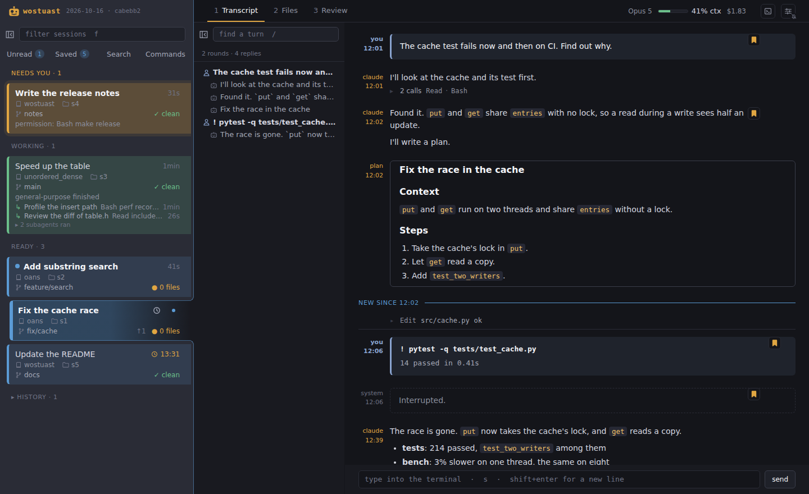

<div align="center">

# wostuast

**See what your Claude Code agents are doing: who needs you, what they said, what they changed.**

*"wos tuast?"* is Austrian for *"what are you doing?"*

[](https://github.com/martinus/wostuast/actions/workflows/tests.yml)


[](LICENSE)

[Why wostuast](#why-wostuast) · [Install](#install) · [A short tour](#a-short-tour) · [The guide](docs/GUIDE.md)



<sub>Made-up sessions, drawn by `python3 tests/tour.py out --view transcript --height 860`.</sub>

</div>

---

You run several Claude Code agents, one per tmux window. A terminal is a good
place to type and a bad place to read. **wostuast is the reading side.** It is
one page in your browser. It tells you which agent needs you, what each agent
said, and what each agent changed. And it lets you answer, without a hunt for
the right window.

## Why wostuast

- **Who needs you, at a glance.** The sessions are grouped by state: needs
  you, working, ready. The browser tab's icon and title say it too, and an
  alert tells you when an agent waits. You see it from another window, or
  from another room.
- **A tight loop with the agent.** Answer an agent's question, say Yes or No
  to a permission request (the page shows the whole request), or send a
  message, from the page. Write a review on the diff, line by line, and send
  it to the agent in one go. Everything goes into the agent's own tmux pane,
  and nothing goes until you press the button.
- **Git built in.** The Files tab shows every file of the worktree, with
  syntax colour, and marks what changed. The Review tab shows the diff
  against the branch the work came from, commit by commit, with the changed
  words marked. No editor and no pull request needed.
- **It reads what agents write.** Replies, plans and Markdown files are drawn
  as Markdown. A long run of tool calls is one line. You search every
  session, keep any message for later, and catch up on all unread answers in
  one scroll.
- **Local only.** One page on `127.0.0.1`. Nothing leaves your machine. On
  Linux the page answers only you: another account on the machine gets
  nothing. Use it from another computer through an SSH tunnel.
- **One file.** A single Python file, the standard library and nothing else.
  No build step, no `pip install`, no config file. The hooks only append to a
  log, so nothing is lost while the page is not running.

> [!NOTE]
> **wostuast never owns your agents.** tmux does. wostuast reads files, and
> types into an agent's pane only what you send from the page.

## Install

**You need:** Python 3.10 or newer, Claude Code, and tmux. git makes the Files
and Review tabs work.

```sh
python3 -c "$(curl -fsLS https://raw.githubusercontent.com/martinus/wostuast/main/wostuast)" install
```

This copies one file to `~/.local/bin/wostuast` and adds its hooks to
`~/.claude/settings.json`. It changes nothing else in that file.

> [!IMPORTANT]
> Restart your Claude Code sessions after the install. A running session does
> not pick up new hooks.

Then start it. It checks the setup, brings what is behind up to date, and
opens the page:

```sh
wostuast --open
```

On another machine, forward the port with
`ssh -N -L 7331:127.0.0.1:7331 you@your-server` and open
<http://127.0.0.1:7331>. To update, run `wostuast install` again. To remove
it, run `wostuast uninstall`. The [guide](docs/GUIDE.md#install) has the
details.

## A short tour

| Where | What it does |
| --- | --- |
| **The session list** | One card a session, grouped by state. Snooze one ("not now"), set a reminder ("later"), mark it unread, rename it. What an agent started shows under its card. |
| **Transcript** | What the agent said and did, with a map of the conversation beside it. Answer, say Yes or No, and send from here. |
| **Files** | Every file in the worktree as a tree, with go-to-file. A funnel shows only what changed. |
| **Review** | The diff, file by file and commit by commit. Click the `+` beside a line to comment, then send the review to the agent. |
| **Unread, Saved, Search, Commands** | The last answer of every unread session; the messages you kept; a search of every session; every skill and command your sessions can run. |
| **`wostuast ls`, `wostuast wait`** | The sessions in a terminal, or as JSON for a script; wait until a session is done. |

Press <kbd>?</kbd> on the page for the keys. The [guide](docs/GUIDE.md)
explains each part, the settings, the commands, the files wostuast writes,
how it keeps the page safe, and the FAQ.

## How it works

Claude Code runs a hook on every event. The hook appends one JSON line to a
log and exits. `wostuast` reads that log and the agents' transcripts, and
serves one page that updates itself. When you act on the page, it types into
the agent's tmux pane. [ARCHITECTURE.md](ARCHITECTURE.md) tells the whole
story.

## Status

All seven planned milestones are done. [`CLAUDE.md`](CLAUDE.md) holds the
design, the reasons behind it, what was left out on purpose, and how to work
in this repository.

## License

MIT. See [LICENSE](LICENSE).
